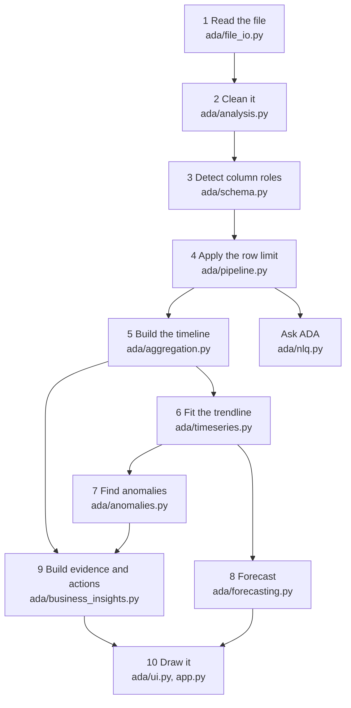
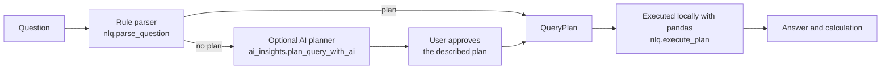

# How it works

The path from an uploaded file to a dashboard, in order. Each step names the
module that owns it.

`ada.analyze` runs steps 1 to 4 when called and computes the rest on demand.

## 1. Read the file

`ada/file_io.py` · [details](reference/reading-files.md)

Accepts `.csv`, `.xlsx` and `.xlsm`. A CSV may be comma, semicolon, tab or pipe
separated. For a workbook with several sheets, the app asks which one to
analyze; ADA analyzes one sheet at a time.

The app refuses files over 25 MB (`MAX_UPLOAD_BYTES` in `app.py`).

## 2. Clean it

`clean_dataframe` in `ada/analysis.py` · [details](reference/cleaning.md)

Makes column names unique, drops fully empty rows and columns and exported
index columns, trims text, and converts text columns to numbers or dates when
nearly all values convert. Identical rows are counted and kept.

Each change is counted in a `CleaningReport`, which the app shows as the
cleaning audit table, with notes for date-order assumptions and similar
decisions.

## 3. Detect column roles

`detect_roles` in `ada/schema.py` · [details](reference/schema-detection.md)

Picks the measure, date, segment and identifier from column names, data types
and distinct-value counts. Any role can be overridden in the app's "Tune ADA's
schema detection" panel, or with `date=`, `measure=` and `dimension=` in
`ada.analyze`.

## 4. Apply the row limit

`prepare_analysis` in `ada/pipeline.py`

At most 1,000,000 rows are analyzed (`MAX_ANALYSIS_ROWS` in `app.py`,
`DEFAULT_ROW_LIMIT` in `ada/api.py`). ADA keeps the most recent rows by the
detected date column. A table with no date has no most recent rows, so a
seeded random sample is taken instead, in file order, before cleaning so the
rows left out cost nothing. If the cut splits the oldest period, that period
is dropped too. The app, `print(report)` and every answer from `report.ask`
say which rows were analyzed.

Before the limit, rows at a coarser grain (daily summaries below hourly
readings) are set aside, and logs stacked one after another in the file get a
`Block` column; see [Cleaning](reference/cleaning.md#rows-at-a-coarser-grain).

## 5. Build the timeline

`ada/aggregation.py` · [details](reference/periods.md)

The only module that decides what a period is. It picks a grain from the span
of the dates and from how often rows are recorded, then totals (money and
counts) or averages (everything else) the measure per period. It excludes a trailing period the
data only partly covers and fills empty periods.

The result is a `TrendSeries`: the frame, the grain, and notes describing the
adjustments. Segment totals, the movement waterfall and the segment × period
heatmap are built here too.

## 6. Fit the trendline

`ada/timeseries.py` · [details](reference/periods.md#the-trendline)

Fits a Theil-Sen line on calendar positions and measures the spread of the
residuals with a robust scale. Anomaly detection and the forecast both use this
fit.

## 7. Find anomalies

`ada/anomalies.py` · [details](reference/anomalies.md)

Flags periods further from the trendline than a calibrated band. Needs at least
8 periods. Each flag carries the observed value, the expected value and range,
the direction and the severity.

## 8. Forecast

`ada/forecasting.py` · [details](reference/forecasting.md)

Extends the trendline, with month-of-year seasonality when there is enough
monthly history. Needs at least 8 periods and forecasts at most half the
history length. Each forecast includes a backtest that states whether it beat
a no-change forecast. With too little history it returns nothing.

## 9. Build evidence and recommendations

`analyze_business` in `ada/business_insights.py` · [details](reference/evidence.md)

Builds the `BusinessBrief`: a headline from the most informative finding, up
to four KPIs, up to eight evidence cards and up to four prioritized
recommendations.

Evidence kinds: `trend`, `driver`, `leader`, `concentration`, `shift`,
`differences`, `rates`, `anomaly`, `relationship`, `model`, `outliers`,
`quality`. Each card carries its calculation, naming the method and the
library function behind it ([credits](credits.md)). Group comparisons, rate
comparisons, the joint model and the relationship scan come from
`ada/compare.py` ([details](reference/compare.md)); the change-in-level check
from `ada/timeseries.py` ([details](reference/periods.md#level-shifts)).

Before the cards are built, the data checks in `ada/quality.py` scan every
numeric column for impossible values, missing-value codes, caps, fill values,
extreme values, swapped, copied and stuck columns and patterns in the gaps,
and the table for copied rows and simulated-looking data
([details](reference/quality.md)). The `quality` card lists the issues covering
the most rows, and the summary says which to check first when one touches the
measure or the leading group or covers much of the table. Relationships, group
comparisons and outlier counts are computed with the flagged cells left out.

## 10. Draw it

`ada/ui.py` renders components and styles the Plotly charts. `app.py` builds
the Streamlit page and holds session state. `ada/pipeline.py` sits between
them: it bundles steps 1 to 3 into one call and handles drill-down and slices
selected on the Explore chart. Neither `ada/ui.py` nor `app.py` calculates
anything; see [Architecture](architecture.md).

---

## The Ask ADA path

Questions start from the same cleaned data and roles as the dashboard.

The rule parser gives no plan when the question names a column, value,
grouping or condition the plan would leave out, and says which part and why.
The AI planner runs only when the rules cannot parse a question and an API key
is set. It sees column names, types and roles, not rows. Its plan is validated,
described in one sentence, and run only if the user approves it. Both paths end
in the same executor. See [Ask ADA](reference/ask-ada.md).
